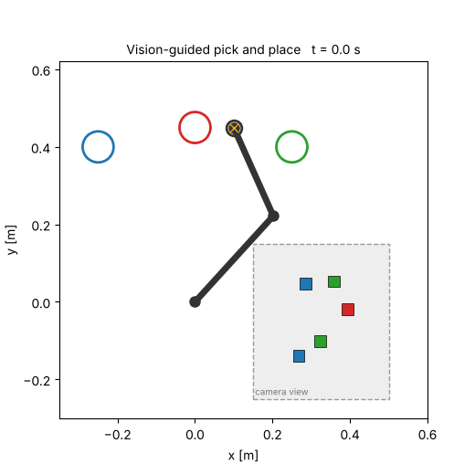
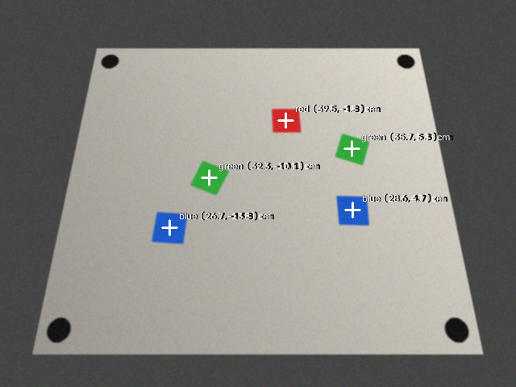
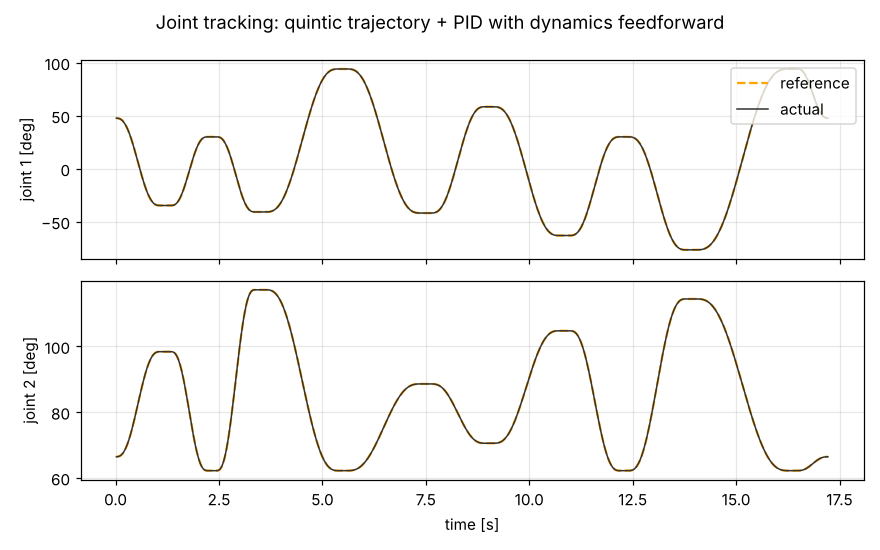

# Vision-Guided Pick-and-Place Robot Arm (Simulation)

A 2-link SCARA-style robot arm that **sees** coloured cubes with an overhead camera, **plans** smooth motions, and **sorts** each cube into the bin of its colour. Everything is simulated in Python: no hardware or ROS install needed.



## What it does

```
camera image ──► calibration (homography) ──► colour detection (OpenCV, HSV)
                                                        │
                                                        ▼ object positions in metres
         pick-order optimisation ◄──────────────────────┘
                    │
                    ▼
   inverse kinematics ──► quintic trajectory ──► PID + dynamics feedforward ──► arm dynamics
```

| Module | What it does |
|---|---|
| `pickplace/vision.py` | Renders a tilted camera view, finds 4 calibration markers, computes a pixel→world homography, detects cubes by HSV colour thresholding |
| `pickplace/kinematics.py` | Forward kinematics, analytic inverse kinematics (picks the elbow solution closest to the current pose), Jacobian |
| `pickplace/trajectory.py` | Quintic joint trajectories with velocity and acceleration limits |
| `pickplace/dynamics.py` | Full 2-link rigid-body dynamics: mass matrix, Coriolis/centrifugal terms, friction, torque limits |
| `pickplace/control.py` | Joint PID (gains from target natural frequency and damping) with model-based feedforward |
| `pickplace/sim.py` | Scene generation, pick-order strategies (naive / greedy / optimal), closed-loop execution and success checks |

## Results (50 random scenes, 234 cubes)

| Pick order | Controller | Success | Avg. cycle time | RMS tracking error | Max tracking error |
|---|---|---|---|---|---|
| Naive (detection order) | PID + feedforward | 100% | 16.56 s | 0.54 mm | 1.90 mm |
| Greedy (nearest next) | PID + feedforward | 100% | 16.18 s | 0.57 mm | 1.91 mm |
| **Optimal (all permutations)** | PID + feedforward | 100% | **15.16 s** | 0.61 mm | 1.93 mm |
| Greedy | PID only | 100% | 16.17 s | 3.02 mm | 11.33 mm |

- **Vision:** mean localisation error **0.38 mm** after homography calibration.
- **Motion optimisation:** choosing the best pick order cuts cycle time by **8.4%**.
- **Control:** adding dynamics feedforward to PID cuts RMS tracking error by **81%** (3.02 → 0.57 mm). Without it the worst error (11.3 mm) comes close to the 12 mm gripper tolerance.

| Camera view with detections | Joint tracking |
|---|---|
|  |  |

## Run it

```bash
pip install -r requirements.txt
python tests/test_core.py        # unit tests
python run_demo.py               # one episode -> results/demo.gif and images
python run_benchmark.py          # 50 scenes -> results/benchmark.json (takes ~4 min)
```

## Simplifications

This is a simulation study, not a hardware system. The camera image is synthetic (with noise, uneven lighting and perspective), the vertical gripper motion is modelled as a fixed grasp/release time, and the arm moves in a horizontal plane (no gravity on the joints).

## Next steps

- Port to ROS 2 with Gazebo and MoveIt 2 (vision node, planner node, controller node).
- Extend to a 6-DOF arm with numerical inverse kinematics using the Jacobian.
- Replace colour thresholding with a learned object detector.
